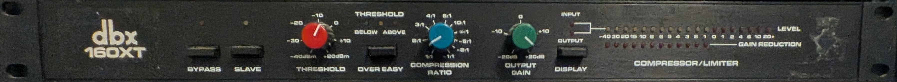

# JB 160XT

A JUCE/C++ VST3 compressor modelled on my own dbx 160XT. It keeps the hardware's front panel layout and models its audio behaviour from the real circuit: RMS detector, hard knee and OverEasy, a ratio law that runs through infinity to negative ratios, and stereo strapping that sums power across channels.



## Features

- Threshold, compression ratio (1:1 … ∞:1 … −1:1), output gain, OverEasy, bypass, slave (stereo link) and input/output display, as on the hardware
- 19-segment level meter, 12-segment gain-reduction meter, BELOW / OverEasy / ABOVE threshold LEDs
- External detector input (sidechain) on a VST3 sidechain bus, which you switch from the panel's right-click menu. Kick-to-808 ducking in FL Studio works well with it.
- Mono and stereo
- DSP headers with no JUCE dependency, plus a plain C++ test suite checked against the factory test procedure

## Building

Requirements: CMake ≥ 3.22, Visual Studio 2022 (Windows), and a JUCE checkout (developed against JUCE 9.0.1).

```
cmake -S . -B build -G "Visual Studio 17 2022" -A x64 -DJUCE_DIR_PATH=C:/JUCE
cmake --build build --config Release
build\Release\jb160_dsp_tests.exe
```

The VST3 ends up in `build/JB160XT_artefacts/Release/VST3/JB 160XT.vst3`. Copy it to `C:\Program Files\Common Files\VST3` to install it.

| Target | Purpose |
| --- | --- |
| `JB160XT_VST3`, `JB160XT_Standalone` | The plugin |
| `jb160_dsp_tests` | DSP checks against the factory procedure and published specs |
| `jb160_render_panel` | Renders the editor to PNG for comparison with the hardware photo |

## Project notes

- [HANDOFF.md](HANDOFF.md): current state, code map, how the model works, known issues
- [Documentation/PROJECT_MEMORY.md](Documentation/PROJECT_MEMORY.md): full decision log
- [Documentation/07_Hardware_Measurement_Plan/MEASUREMENT_PLAN.md](Documentation/07_Hardware_Measurement_Plan/MEASUREMENT_PLAN.md): how the model will be refit against hardware captures

The research notes refer to service manuals, schematics, datasheets, papers and vendor material. Those files belong to their owners, so they aren't in this repository, and links to them in the notes won't resolve here.

## License

[AGPL-3.0](LICENSE), which matches JUCE's open-source license. The Michroma font is under the SIL Open Font License ([Assets/fonts/OFL.txt](Assets/fonts/OFL.txt)).

## Disclaimer

This is an independent hobby project. It isn't affiliated with or endorsed by dbx or Harman. "dbx", "160XT" and "OverEasy" are trademarks of their respective owners and are used here only to describe the hardware this project models.
